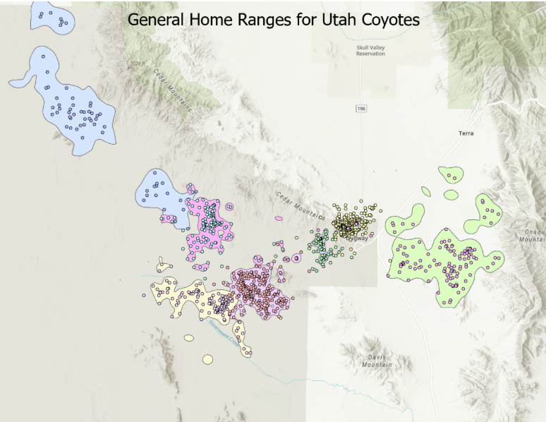

# <ins> Coyote Home Ranges in Western Utah </ins>

## Overview
This project maps the home ranges of coyotes in Western Utah utilizing GPS
location data and displayed using ArcGIS Pro. On top of this,
it also looks at where coyote locations are most concentrated.

## What's in this repository
- `HomeRange/` – This folder includes the data,
  such as the home range polygons and location frequency information.
